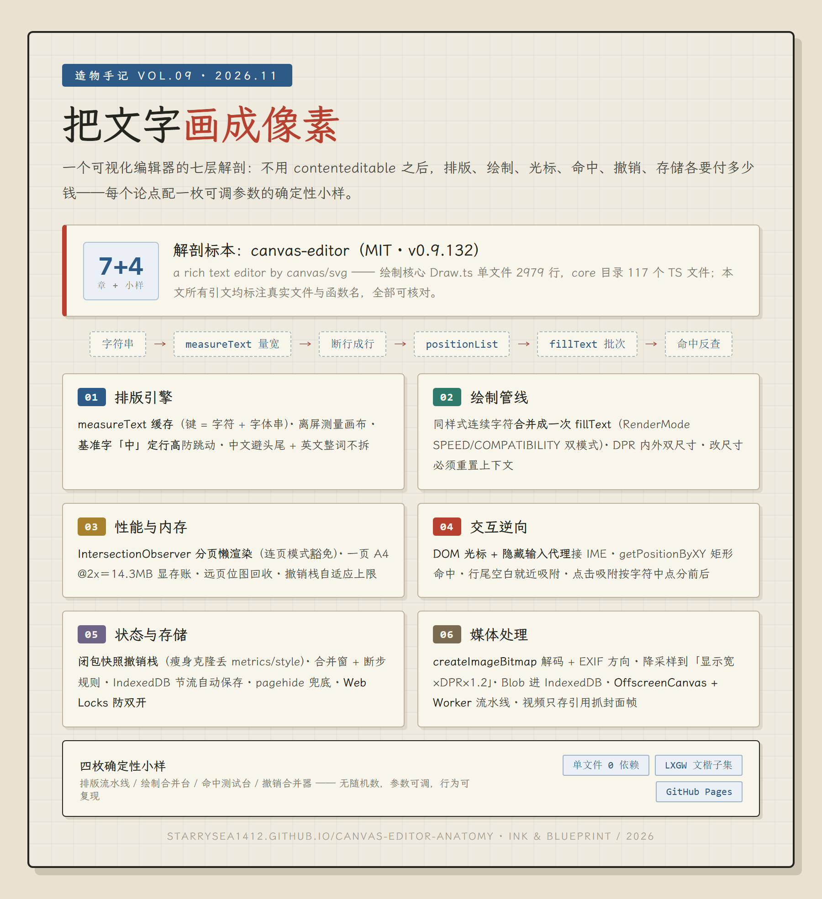

# 把文字画成像素 · 造物手记 VOL.09

> 从一条招聘要求出发：有画布、白板、流程图、节点工作流、编辑器的实际经验，「只做过管理后台表格页面的不合适」。

**[打开这一页 →](https://starrysea1412.github.io/canvas-editor-anatomy/)**



一条前端 JD 写着：可视化编辑器经验、Canvas/SVG 性能、localStorage/IndexedDB 自动保存与多标签页隔离、图片视频前端处理。这篇把它们当成同一台机器的四个面来解剖：**标本是开源项目 canvas-editor（MIT，v0.9.132）**——绘制核心 Draw.ts 单文件 2979 行，core 目录 117 个 TS 文件。一个字符从字符串走到像素，中途被测量一次、断行一次、定位一次、绘制一次、命中一次；每一层都配了真实源码引文（可核对到函数名），和一枚能拨参数的确定性小样。

## 七章

| # | 章节 | 讲什么 |
|---|---|---|
| 01 | 不用 contenteditable 的账本 | 六件浏览器白送的事换成 canvas 之后各要付多少钱；六层解剖图 |
| 02 | 一次字符测量的旅行 | measureText 缓存键＝字符＋字体串；基准字「中」定行高；避头尾与整词不拆；排版是 O(文档长度) |
| 03 | 把像素按批次交给 GPU | 同样式连续字符合并成一次 fillText；分页懒渲染；DPR 内外双尺寸与上下文重置坑 |
| 04 | 光标与那一「下」 | 光标为什么是 DOM div；IME 隐藏输入代理；坐标表矩形命中与就近吸附；「手感」的七条踩坑表 |
| 05 | 撤销栈与自动保存的账 | 闭包快照栈（瘦身克隆丢 metrics/style）；合并窗与断步；localStorage 三限制与 IndexedDB 正确姿势 |
| 06 | 三笔烂账 | 多标签页（Web Locks / 乐观并发 / 实时协同三档）、页 canvas 显存账（一页 A4 @2x＝14.3MB）、媒体五道关 |
| 07 | 一张自检清单 | 26 个照着问的问题 + 一周最小实现路径 |

## 四枚可玩小样

全部是**确定性模型**，不是录屏：无随机数、参数可调、行为可复现，估算口径在小样说明里标明。

- **排版流水线**：逐字量宽、贪心断行实时可视化；标尺、行尾剩余、折行起点；「按全角估算 vs 逐字测量」的行数对照
- **绘制合并台**：真 canvas 实画，统计 fillText 调用次数——合并 vs 逐字、混排密度对合并收益的影响
- **命中测试台**：真实 DOM 文本 + 实测坐标表，「逐个扫描」与「行索引＋吸附」两种算法逐步日志，行尾空白吸附演示
- **撤销合并器**：确定性时间轴（每键 180ms、标点断步），看合并率、栈内存、撤销代价随时间窗的变化；上限溢出时最早历史被 shift() 丢弃

## 本地构建

```bash
node build/build.mjs          # 拼接单文件 index.html（多文件源在 build/）
node build/render-stack.mjs   # docs/tech-stack.html → assets/tech-stack.png（需本机 playwright）
node build/verify.mjs         # 无头验收：逐小样状态截图 + 报错收集 + 移动端溢出（→ shots/）
```

字体：LXGW 文楷子集（OFL 许可，见 `assets/fonts/OFL.txt`），字符清单在 `build/chars.txt`。

---

造物手记系列：[VOL.08 Agent 的三条信号线](https://starrysea1412.github.io/agent-signals/) · [VOL.07 把能力打包成技能](https://starrysea1412.github.io/agent-skillcraft/) · [VOL.06 给 Agent 打分](https://starrysea1412.github.io/agent-eval/) · [VOL.05 让 Agent 亲眼看一眼](https://starrysea1412.github.io/seeflow-story/)
